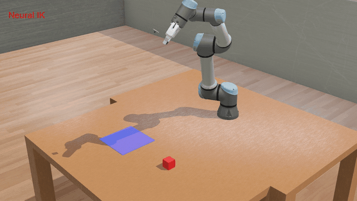

# UR5e Neural Kinematics

Neural inverse kinematics for a UR5e arm, trained through a differentiable model of the robot's forward kinematics: 0.19 mm mean position error on 2,021 held-out test targets and 0.53 ms per solve, running inside a camera-guided pick-and-place loop in Webots.

**Full report:** [`paper/main.pdf`](paper/main.pdf), an 11-page preprint with the multi-seed results, the verification and the references.

[](https://github.com/clementdumeril/ur5e-neural-kinematics/actions/workflows/smoke.yml)
[](LICENSE)



*One run of [`my_first_simulation_pandahand.wbt`](webots/worlds/my_first_simulation_pandahand.wbt), sped up 2×: the camera locates the cube, the network solves every move to the cube and the tray, and the arm drops the cube in the tray. Recorded with [`capture_recorder.py`](webots/controllers/capture_recorder/capture_recorder.py).*

I built this as a personal project in August and September 2026, on top of an open-source Webots pick-and-place scene. The arm finds a red cube with its camera, turns the cube position into six joint angles, grasps the cube and drops it in a tray. I wanted to know whether a small network could do the IK step inside that loop, and what training it through the robot's kinematics buys over plain regression on joint angles.

The network solves position IK with the tool held pointing down (R³ → R⁶). It takes no orientation as input, so it is not full 6-DoF pose IK.

Key decision: I fixed the IK branch in the data generator instead of learning it, because the multi-head model that learns it has about twice the error on this task (0.40 against 0.21 mm on the test set).

Stack: PyTorch, Webots, DH kinematics / geometric Jacobian / damped least squares, homography calibration.

## Results

| | Value | Source |
| :-- | --: | :-- |
| Position / orientation error of the shipped model, 2,021 held-out test targets | 0.191 mm / 0.009° | [`C_shipped.json`](results/seed_study/C_shipped.json) |
| Same architecture and loss, 5 seeds, smaller training split (16.2k targets), test set | 0.214 ± 0.039 mm | [`results/seed_study/`](results/seed_study/) |
| Solve time, median, one thread, tensor conversion included | 0.531 ms | [`benchmark.json`](results/benchmark/benchmark.json) |
| Against IKPy on the same pose problem / against the closed-form solver | 72× faster / 2.3× slower | same |
| Effect of the FK terms on single-branch data, 5 paired seeds | 11% lower on average, not significant (95% CI −13% to +34%) | [`results/seed_study/`](results/seed_study/) |
| Branch-mixed data, no labels: IK branches recovered with 1 → 8 heads | 13% → 78% (4 branches), 14% → 51% (8 branches) | [`results/seed_study/`](results/seed_study/) |


*Same 200 pose targets for every solver, one thread, 200 warm-up calls on other targets. From the rest configuration, IKPy and single-start damped least squares fail on 58% and 60% of targets.*

## What I built

I started from [`allan-almeida1/ur5-pick-and-place-webots`](https://github.com/allan-almeida1/ur5-pick-and-place-webots) (MIT), which gave me the Webots scene, a NumPy Denavit–Hartenberg forward kinematics, the closed-form IK with its 8 branches, quintic trajectories and the device wrappers in `ur5.py`. Everything below is mine; [`CREDITS.md`](CREDITS.md) draws the line file by file.


### Differentiable forward kinematics

Code: [`ur5_pytorch_fk.py`](src/kinematics/ur5_pytorch_fk.py). The UR5e DH chain rewritten as a batched PyTorch module, six homogeneous transforms multiplied with `torch.bmm`. An end-effector error in metres can now send a gradient back to the joint angles.

### The network

Code: [`pinn.py`](src/models/pinn.py), class `PINN6DOF`. The MLP in the figure above, 530,438 parameters. SiLU because it is smooth and the gradient passes through the sines and cosines of the FK; I did not compare against ReLU.

### The loss

Code: [`train_true_pinn.py`](src/training/train_true_pinn.py). The error is computed on the pose the predicted angles reach, as in the figure. The data term keeps the network on one IK branch. On single-branch data the FK terms gave no reliable gain over the data term alone (next section); their use shows on branch-mixed data, where a loss on the reached pose does not average the branches. Adam, 1e-3 decayed to 2e-5, batch 256, 100 epochs.

<details>
<summary>The loss in full, and why it is built this way</summary>

$$L = 0.1 \cdot \lVert q - q_{ref} \rVert^2 + \lVert p - p^{*} \rVert^2 + r_{tool}^2 \cdot \lVert R - R_{ref} \rVert_F^2$$

- $r_{tool} = 0.05$ m turns a rotation error into the tip displacement it causes (1° ≈ 0.9 mm), so both FK terms are in m².
- Comparing against $FK(q_{ref})$ instead of a matrix rebuilt from Euler angles puts both sides through the same kinematics, so no angle convention can create a fake error. Without an orientation term at all, turning q6 by 180° flips the gripper without moving the point, and the loss cannot see it.
- The geodesic angle involves an arccos whose gradient blows up near zero error, exactly where training has to converge. The Frobenius norm has no such problem.
</details>

### The dataset generator

Code: [`train_true_pinn.py`](src/training/train_true_pinn.py). 25,000 targets drawn uniformly in x ∈ [0, 0.4], y ∈ [−0.9, −0.5], z ∈ [0.05, 0.45] m, solved by the closed form on one branch (shoulder left, elbow up, wrist up). About 20,000 are reachable, split 90/10. The experiments use a separate 80/10/10 split: epoch chosen on validation, error reported on test.

### Multi-head IK

Code: [`multihead.py`](src/models/multihead.py), [`multihypothesis_ik.py`](experiments/multihypothesis_ik.py). A shared trunk with K heads, trained with a relaxed winner-take-all loss on data that mixes IK branches, without branch labels. At inference the FK scores the K proposals and the closest one wins.

### Jacobian and damped least squares

Code: [`jacobian.py`](src/kinematics/jacobian.py), [`ik_dls.py`](src/kinematics/ik_dls.py). Geometric Jacobian and an adaptive Levenberg–Marquardt IK, written as a benchmark baseline.

### A fix to the inherited closed form

Code: the "Theta 2" block of [`inverse_kinematics`](src/control/ur5.py). Round-tripping FK(IK(p)) showed that every elbow-down solution of the inherited solver was finite but about 0.78 m off: θ2 was chosen from the shoulder only, while θ3 followed the elbow. Pairing θ2 with the elbow choice makes all eight branches exact, and the smoke test now checks them.

### Perception

Code: [`ur5.py`](src/control/ur5.py#L1015) (`vision_calibration`, `pixel_to_robot`, [`detect_cube_color`](src/control/ur5.py#L1156)), [`data_collector.py`](webots/controllers/data_collector/data_collector.py).

- Pixel-to-table mapping: the inherited constants came from another scene and were 148 mm off. I wrote a calibration run that places the cube on a grid in the camera's field and fits a homography with RANSAC: 1.1 mm median residual.
- Camera mount: tilted 17.2°. I identified the optical axis by casting a ray along each local axis of the camera, then corrected the mount to 0.07°.
- Detector: a colour threshold and centroid, 8 mm error against 49 mm for the VGG16 regressor I also tried on the same 200 images, so I dropped the VGG16.

### Control

Code: [`move_to_config`](src/control/ur5.py#L730) and the neural IK bridge in [`move_to_pose`](src/control/ur5.py#L889). A closed-loop hold on joint position at the end of each move, which removed 114 mm of error that built up in open loop.

## How it works


In Webots the network solves every move to the cube and to the tray. The camera reading pose (x = −0.10 m) is outside the training box, where the network would be 3.2 mm off and shift the camera, so that one move stays on the closed form. The tray (x = −0.20 m) is outside the box too; the network is 7 to 11 mm off there, which the drop tolerates.

## How I checked it

### Ablation of the loss

Over 5 paired seeds on a held-out test set, the FK terms move the error from 0.241 ± 0.021 to 0.214 ± 0.039 mm. They help in 3 of 5 seeds; the difference is not significant (p = 0.26).


<details>
<summary>Protocol, the earlier 21% figure, and the branch-mixed case</summary>

Same data, architecture and schedule; only the loss and the seed change. Epoch chosen on validation, error measured on 2,021 test targets. An earlier version of this README reported a 21% reduction from a single run whose epoch was chosen and reported on the same validation set; it does not hold over seeds. On branch-mixed data a supervised network collapses to 911 mm, the average of several valid configurations, and even with the FK terms weighted 20× it only reaches 3.68 mm with 71.6° of orientation error. That single-run 2 × 3 table is in [`docs/experiments.md`](docs/experiments.md#1-physics-term-ablation); the paper re-runs its single-branch half over seeds (Section 6.2).
</details>

### Multi-head sweep

On branch-mixed data, without branch labels, more heads recover more of the solution set but are not more accurate: every run with 2 to 8 heads stays between 0.26 and 0.62 mm.


<details>
<summary>The single-head case, eight branches, and the cost</summary>

With one head and the FK loss alone, the network settles on one branch by itself in 2 of 3 seeds (0.33 to 0.44 mm) and stalls between branches in the third (4.4 and 8.8 mm). The 911 mm collapse comes from the supervised term on mixed labels, not from having a single output. The sweep was run on the four elbow-up branches and, after the solver fix, on all eight. Against single-branch training, two heads have about twice the error and are 8× slower (4.0 against 0.53 ms). Tables in Section 6.3 of the paper.
</details>

### Error on the simulated robot

0.33 mm at the grasp point and 0.45 mm above the cube, against at most 0.04 mm for the arm's own repeatability; 7 to 11 mm above the tray, outside the training box. Measured on the shipped model in October 2026, in the same run where the camera located the cube and the grasp succeeded ([`closed_loop_console.txt`](results/webots/closed_loop_console.txt)).

<details>
<summary>How it is measured</summary>

`mesurer_erreur_pinn()` sends the arm to the same target with the closed form and with the network and compares the poses reached in the physics engine, not the network's own FK. One target per point, so these are single measurements. An earlier model, trained without the orientation term, gave 0.30 mm at the grasp point.
</details>

### Timing and the Jacobian

Timings discard 200 warm-up calls and run on one thread. The Jacobian matches a central-difference derivative of the FK to 3.2 × 10⁻¹⁰.

I removed three claims from earlier versions of this README after measuring them; [`docs/experiments.md`](docs/experiments.md#7-claims-i-withdrew) lists them.

Corrections in October 2026: the 21% gain from the FK terms did not hold over five seeds on a test set (see above), and the statement in `docs/` that only 4 of the 8 IK branches exist with the tool pointing down was wrong; it came from the closed-form bug fixed above.

## Limitations


- On this z = 0.25 m slice the median error is 0.176 mm inside the training box and 14.3 mm outside it.
- Past the reach limit the network still returns six angles, up to 1.78 m off, with no warning; the closed form raises an exception. A deployment needs a reachability check in front of the network.
- One tool orientation and one IK branch: no side approach, no elbow-down route around an obstacle.
- Everything runs in simulation.

## Reproduce

```bash
git clone https://github.com/clementdumeril/ur5e-neural-kinematics.git
cd ur5e-neural-kinematics
pip install -r requirements.txt
```

```bash
python tests/test_smoke.py                    # imports, paths, a known target        (seconds)
python src/training/train_true_pinn.py        # retrain the network                   (~8 min)
python experiments/ablation_physics_loss.py   # loss ablation                         (~1 h)
python experiments/multihypothesis_ik.py      # multi-head IK                         (~55 min)
python experiments/mesure_continuite.py       # continuity and reach boundary         (~1 min)
python experiments/benchmark_solveurs.py      # six solvers, timed                    (~4 min)
python experiments/heatmap_erreur.py          # workspace error map                   (~3 min)
python experiments/figures.py                 # SVG figures from the result files     (seconds)
```

For the simulation, install Webots R2023a or later (tested on R2025a), open `webots/worlds/my_first_simulation_pandahand.wbt` and press Play. The worlds load the `UR5e`, `PandaHand` and `Table` PROTOs from GitHub, so the first launch needs an internet connection.

<details>
<summary>If Webots picks the wrong Python interpreter</summary>

The controllers use whichever `python` is on your `PATH`. To force one, add to `webots/controllers/*/runtime.ini`:

```ini
[python]
COMMAND = C:/path/to/your/python.exe
```

Webots does not accept `#` comments in `runtime.ini`.
</details>

<details>
<summary>Repository layout</summary>

```
src/kinematics/    DH forward kinematics (NumPy and differentiable PyTorch), Jacobian,
                   damped least squares, closed-form IK, quintic trajectories, IKPY baseline
src/models/        pinn.py (single output), multihead.py (K heads)
src/training/      physics-informed and supervised training
src/control/       ur5.py: robot driver, IK bridge, perception
experiments/       ablation, multi-head IK, continuity, benchmark, error map, figures
webots/            worlds and controllers
checkpoints/       trained weights and raw experiment results (JSON)
data/              camera calibration and homography
vision/            VGG16 notebook (negative result; weights not tracked)
docs/              full experiment tables
tests/             smoke test, run by CI
```

`GUIDE_DES_CODES.md` and `DOCUMENTATION.md` are my working notes, in French.
</details>

## Credits

The Webots scene and the base of `src/control/ur5.py` (DH kinematics, closed-form IK, quintic trajectories, device wrappers) come from [`allan-almeida1/ur5-pick-and-place-webots`](https://github.com/allan-almeida1/ur5-pick-and-place-webots) by Allan Souza Almeida, under the MIT licence. [`CREDITS.md`](CREDITS.md) lists what was inherited and what I wrote.

Clément Dumeril · [clement.dumeril.net](https://clement.dumeril.net) · MIT License, see [`LICENSE`](LICENSE)
