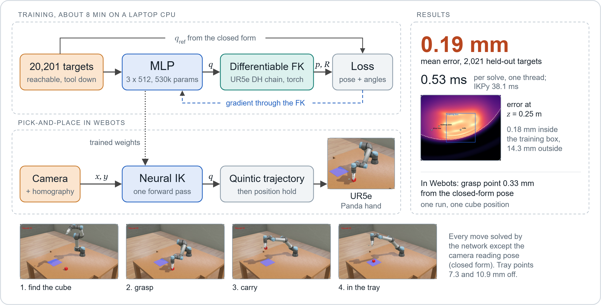

# UR5e Neural Kinematics: position IK trained through a differentiable forward model

[Paper (PDF, 12 pages)](paper/main.pdf) · [Experiment tables](docs/experiments.md) · [Method details and reproduction](docs/REPRODUCING.md) · [Credits](CREDITS.md)

[](https://github.com/clementdumeril/ur5e-neural-kinematics/actions/workflows/smoke.yml)



An MLP solves position inverse kinematics for a simulated UR5e (tool pointing down) at 0.19 mm mean error on 2,021 held-out targets and 0.53 ms per solve, 72x faster than IKPy on the same chain. It drives a camera-guided pick-and-place in Webots, where it reaches the grasp point within 0.33 mm of the closed-form pose.

## Method

The network maps a target position (x, y, z) to six joint angles. During training the predicted angles go through a batched PyTorch copy of the UR5e Denavit-Hartenberg chain, so the loss is measured on the pose the arm reaches and not only on the angles. Labels come from the closed-form IK on one branch (shoulder left, elbow up, wrist up). In Webots, the wrist camera locates the red cube through a homography, the network solves each move and a quintic trajectory drives the arm. Personal project, August to October 2026, simulation only. Training and loop details: [docs/REPRODUCING.md](docs/REPRODUCING.md).

The Webots scene, the NumPy forward kinematics, the closed-form IK and the device wrappers come from [`allan-almeida1/ur5-pick-and-place-webots`](https://github.com/allan-almeida1/ur5-pick-and-place-webots) (MIT). I wrote the differentiable FK, the network and its loss, the dataset generator, the multi-seed study, the multi-head variant, the Jacobian and damped least-squares baselines, the solver benchmark, the color detector and homography calibration, the joint position hold, and a fix to the inherited closed form (every elbow-down solution was about 0.78 m off). [`CREDITS.md`](CREDITS.md) gives the file-by-file split.

## Results

Accuracy on held-out targets (test split of [`seed_study.py`](experiments/seed_study.py), never used for training or epoch selection):

| Model | N | Position error (mm) | Orientation error (deg) | Source |
| :-- | --: | --: | --: | :-- |
| Shipped checkpoint | 2,021 targets | 0.191 mean, 0.164 median, 0.426 p95 | 0.0087 | [`C_shipped.json`](results/seed_study/C_shipped.json) |
| Same recipe, FK loss on | 5 seeds | 0.214 ± 0.039 | 0.0090 ± 0.0013 | [`A_wphys1_seed*.json`](results/seed_study/) |
| Baseline: angle loss only, no FK term | 5 seeds | 0.241 ± 0.021 | 0.0088 ± 0.0009 | [`A_wphys0_seed*.json`](results/seed_study/) |
| Multi-head, K = 8, branch-mixed data, no labels | 3 seeds | 0.305 ± 0.046, recall 50.6 ± 9.3 % of 8 branches | 0.25 ± 0.05 | [`D_K8_seed*.json`](results/seed_study/) |

Mean ± std over seeds. On single-branch data the FK term lowers the error by 11 % on average, which is not significant (95 % CI [-13, +34] %, p = 0.26; it helps in 3 of 5 seeds). All values are generated into [`paper/numbers.tex`](paper/numbers.tex).

Median solve time on 200 pose targets, one thread ([`benchmark.json`](results/benchmark/benchmark.json)): closed form 0.232 ms, network 0.531 ms, IKPy 38.1 ms (58 % failures), damped least squares 136 ms from one start (59.5 % failures) and 270 ms with 8 restarts. Full table: [docs/experiments.md](docs/experiments.md#5-solver-benchmark).


*One run of [`my_first_simulation_pandahand.wbt`](webots/worlds/my_first_simulation_pandahand.wbt) at 2x speed. In closed loop ([`closed_loop_console.txt`](results/webots/closed_loop_console.txt)) the network reaches the grasp point within 0.33 mm and the approach point within 0.45 mm of the closed-form pose; the two tray points, outside the training box, are 10.9 and 7.3 mm off and the cube still lands in the tray.*

## Install and quick start

Tested on Windows 10 with Python 3.11.9 and Webots R2025a, CPU only. CI runs the smoke test on Ubuntu with Python 3.11.

```bash
git clone https://github.com/clementdumeril/ur5e-neural-kinematics.git
cd ur5e-neural-kinematics
pip install -r requirements.txt     # or requirements-tested.txt for the exact versions used
python tests/test_smoke.py          # about 1 min; ends with "Tout est vert." after 8 branches at ~1e-13 mm
python src/training/train_true_pinn.py   # about 8 min, writes checkpoints/pinn_model_true_physics.pth
```

For the simulation, open `webots/worlds/my_first_simulation_pandahand.wbt` in Webots R2023a or later and press Play. The console prints `[Grasp] SUCCESS: the cube followed the arm.` and a `NEURAL IK ERROR MEASURED IN WEBOTS` block. The `controller` module comes with Webots and is not installed by pip. Experiment and figure commands: [docs/REPRODUCING.md](docs/REPRODUCING.md).

## Code structure

| Path | Role |
| :-- | :-- |
| [`src/kinematics/ur5_pytorch_fk.py`](src/kinematics/ur5_pytorch_fk.py) | batched DH chain in PyTorch |
| [`src/models/pinn.py`](src/models/pinn.py), [`multihead.py`](src/models/multihead.py) | `PINN6DOF`; K-head variant with relaxed winner-take-all loss |
| [`src/training/train_true_pinn.py`](src/training/train_true_pinn.py) | dataset generation and the shipped model |
| [`src/kinematics/`](src/kinematics/) | Jacobian, damped least squares and IKPy baselines |
| [`src/control/ur5.py`](src/control/ur5.py) | inherited closed form (fixed), vision, trajectories, position hold |
| [`experiments/`](experiments/), [`webots/`](webots/), [`paper/`](paper/) | seed study and benchmark; worlds and controllers; paper sources |

## Limitations

- Position IK only, at one tool orientation and on one IK branch. "6-DoF" describes the robot, not the problem solved.
- Outside the training box the error grows: 14.3 mm median against 0.176 mm inside, on a z = 0.25 m slice. Past the reach limit the network still returns six angles, up to 1.78 m off, with no warning; it needs a reachability check in front of it.
- The closed-loop Webots figure comes from one run and one cube position, not a success rate over many trials.
- The upstream VGG16 detector was less accurate than the color threshold on this scene and is kept only as an option.
- Simulation only; no test on hardware.

## Citation and license

```bibtex
@misc{dumeril2026ur5e,
  author = {Dumeril, Cl{\'e}ment},
  title  = {Neural Inverse Kinematics Trained Through a Differentiable Forward Model: A Multi-Seed Study on the UR5e},
  year   = {2026},
  url    = {https://github.com/clementdumeril/ur5e-neural-kinematics}
}
```

MIT, see [`LICENSE`](LICENSE), which carries both copyright notices (Clément Dumeril 2026, Allan Souza Almeida 2023).
