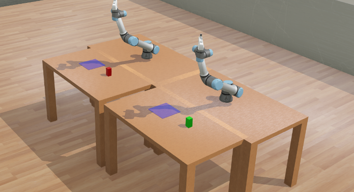
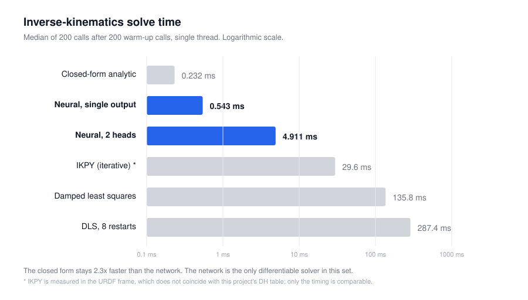
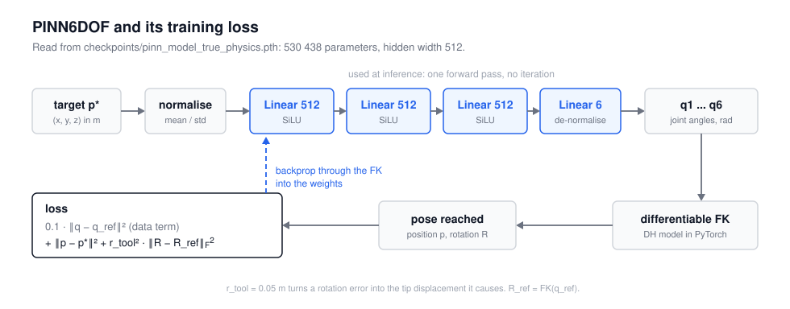
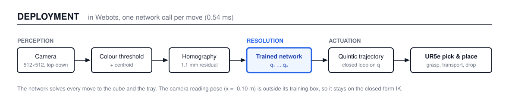
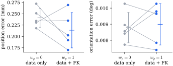
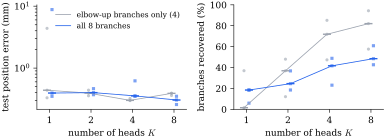
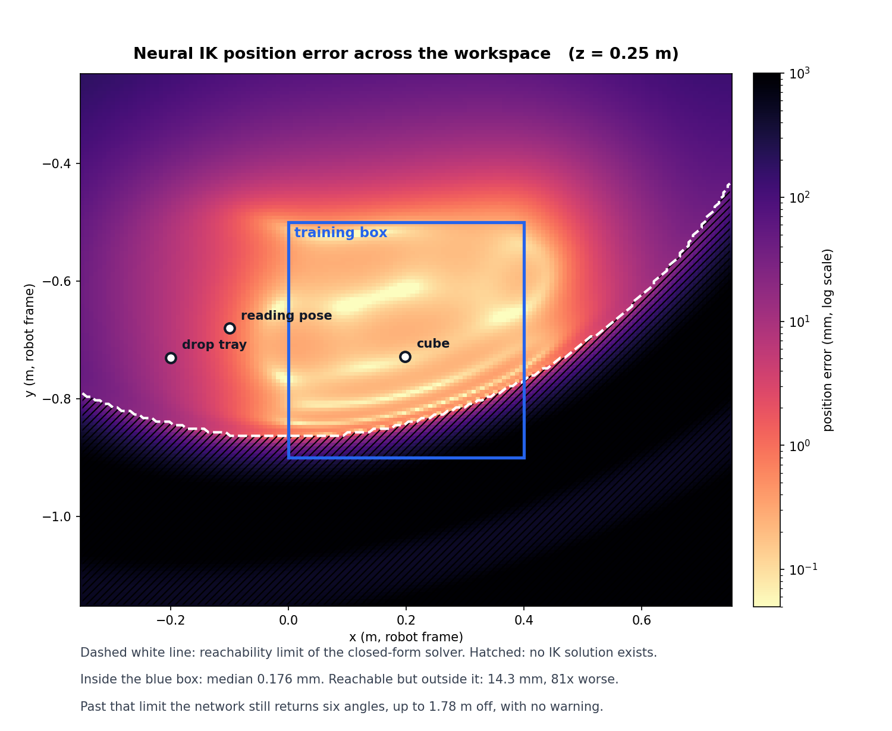

# UR5e Neural Kinematics

Neural inverse kinematics for a UR5e arm, trained through a differentiable model of the robot's forward kinematics: 0.185 mm position error on held-out targets and 0.54 ms per solve, running inside a camera-guided pick-and-place loop in Webots.

[](https://github.com/clementdumeril/ur5e-neural-kinematics/actions/workflows/smoke.yml)
[](LICENSE)



*The comparison scene [`pinn_vs_math.wbt`](webots/worlds/pinn_vs_math.wbt): one arm solves its IK with the network (red cube), the other with the closed-form solver (green cube).*

I built this in August and September 2026 on top of an open-source Webots pick-and-place scene. The arm finds a red cube with its camera, turns the cube position into six joint angles, grasps the cube and drops it in a tray. I wanted to know whether a small network could do the IK step inside that loop, and what training it through the robot's kinematics buys over plain regression on joint angles.

The network solves position IK with the tool held pointing down (R³ → R⁶). It takes no orientation as input, so it is not full 6-DoF pose IK.

Key decision: I fixed the IK branch in the data generator instead of learning it, because the multi-head model that learns it is 1.7× less accurate on this task.

Stack: PyTorch, Webots, DH kinematics / geometric Jacobian / damped least squares, homography calibration.

## Results

| | Value | Source |
| :-- | --: | :-- |
| Position / orientation error, 2,002 held-out targets | 0.185 mm / 0.009° | [`train_true_pinn.py`](src/training/train_true_pinn.py) |
| Solve time, median, one thread, tensor conversion included | 0.543 ms | [`benchmark_solveurs.json`](checkpoints/benchmark_solveurs.json) |
| Against IKPY / against the closed-form solver | 55× faster / 2.3× slower | same |
| Error reduction from the FK terms of the loss (ablation) | 21% | [`ablation_physics_loss.json`](checkpoints/ablation_physics_loss.json) |
| Branch-mixed data, no labels: 2-head model vs best single-output net | 0.314 mm vs 3.68 mm / 71.6° | [`multihypothesis_K2.json`](checkpoints/multihypothesis_K2.json), [`ablation_physics_loss.json`](checkpoints/ablation_physics_loss.json) |



The closed form stays 2.3× faster; the network is the only differentiable solver here.

## What I built

I started from [`allan-almeida1/ur5-pick-and-place-webots`](https://github.com/allan-almeida1/ur5-pick-and-place-webots) (MIT), which gave me the Webots scene, a NumPy Denavit–Hartenberg forward kinematics, the closed-form IK with its 8 branches, quintic trajectories and the device wrappers in `ur5.py`. Everything below is mine; [`CREDITS.md`](CREDITS.md) draws the line file by file.



### Differentiable forward kinematics

Code: [`ur5_pytorch_fk.py`](src/kinematics/ur5_pytorch_fk.py). The UR5e DH chain rewritten as a batched PyTorch module, six homogeneous transforms multiplied with `torch.bmm`. An end-effector error in metres can now send a gradient back to the joint angles.

### The network

Code: [`pinn.py`](src/models/pinn.py), class `PINN6DOF`. An MLP from (x, y, z) to six joint angles: three hidden layers of 512, 530,438 parameters. SiLU activations, chosen because they are smooth and the gradient passes through the sines and cosines of the FK; I did not compare against ReLU.

### The loss

Code: [`train_true_pinn.py`](src/training/train_true_pinn.py). The predicted angles go through the differentiable FK, and the error is computed on the pose they reach:

$$L = 0.1 \cdot \lVert q - q_{ref} \rVert^2 + \lVert p - p^{*} \rVert^2 + r_{tool}^2 \cdot \lVert R - R_{ref} \rVert_F^2$$

The data term alone already reaches 0.238 mm and keeps the network on one IK branch; adding the FK terms takes it to 0.187 mm. $r_{tool} = 0.05$ m turns a rotation error into the tip displacement it causes (1° ≈ 0.9 mm), so both FK terms are in m². Adam, 1e-3 decayed to 2e-5, batch 256, 100 epochs.

<details>
<summary>Why R_ref = FK(q_ref) and the Frobenius norm</summary>

- Comparing against $FK(q_{ref})$ instead of a matrix rebuilt from Euler angles puts both sides through the same kinematics, so no angle convention can create a fake error. Without an orientation term at all, turning q6 by 180° flips the gripper without moving the point, and the loss cannot see it.
- The geodesic angle involves an arccos whose gradient blows up near zero error, exactly where training has to converge. The Frobenius norm has no such problem.
</details>

### The dataset generator

Code: [`train_true_pinn.py`](src/training/train_true_pinn.py). 25,000 targets drawn uniformly in x ∈ [0, 0.4], y ∈ [−0.9, −0.5], z ∈ [0.05, 0.45] m, solved by the closed form on one branch (shoulder left, elbow up, wrist up). About 20,000 are reachable, split 90/10.

### Multi-head IK

Code: [`multihead.py`](src/models/multihead.py), [`multihypothesis_ik.py`](experiments/multihypothesis_ik.py). A shared trunk with K heads, trained with a relaxed winner-take-all loss on data that mixes IK branches, without branch labels. At inference the FK scores the K proposals and the closest one wins.

### Jacobian and damped least squares

Code: [`jacobian.py`](src/kinematics/jacobian.py), [`ik_dls.py`](src/kinematics/ik_dls.py). Geometric Jacobian and an adaptive Levenberg–Marquardt IK, written as a benchmark baseline.

### Perception

Code: [`ur5.py`](src/control/ur5.py#L1013) (`vision_calibration`, `pixel_to_robot`, [`detect_cube_color`](src/control/ur5.py#L1154)), [`data_collector.py`](webots/controllers/data_collector/data_collector.py).

- Pixel-to-table mapping: the inherited constants came from another scene and were 148 mm off. I wrote a calibration run that places the cube on a grid in the camera's field and fits a homography with RANSAC: 1.1 mm median residual.
- Camera mount: tilted 17.2°. I identified the optical axis by casting a ray along each local axis of the camera, then corrected the mount to 0.07°.
- Detector: a colour threshold and centroid, 8 mm error against 49 mm for the VGG16 regressor I also tried on the same 200 images, so I dropped the VGG16.

### Control

Code: [`move_to_config`](src/control/ur5.py#L728) and the neural IK bridge in [`move_to_pose`](src/control/ur5.py#L887). A closed-loop hold on joint position at the end of each move, which removed 114 mm of error that built up in open loop.

## How it works



In Webots the network solves every move to the cube and to the tray. The camera reading pose (x = −0.10 m) is outside the training box, where the network would be 3.2 mm off and shift the camera, so that one move stays on the closed form.

## How I checked it

### Ablation of the loss

Same seed, data, architecture and schedule; only the loss changes. On single-branch data the FK terms take the error from 0.238 to 0.187 mm. (0.187 mm is the ablation's own run on its shared dataset; the shipped model, trained separately by `train_true_pinn.py`, reaches 0.185 mm.) On branch-mixed data a supervised network collapses to 911 mm, the average of several valid configurations, and the FK terms alone only bring it to 3.68 mm with 71.6° of orientation error.



### Multi-head sweep

On that mixed data, two heads reach 0.314 mm and 0.202° with no branch labels; more heads recover more of the solution set (87% at K = 8) but are not more accurate. K = 1 (8.88 mm) has no data term, unlike the 3.68 mm net of the ablation. Against the shipped model, two heads are 1.7× less accurate and about 9× slower (4.9 against 0.54 ms).



### Error on the simulated robot

`mesurer_erreur_pinn()` sends the arm to the same target with the closed form and with the network and compares the poses reached in the physics engine, not the network's own FK. It gave 0.30 mm at the grasp point on the previous model, before the orientation term; the current model has not been re-measured yet.

### Timing and the Jacobian

Timings discard 200 warm-up calls and run on one thread. The Jacobian matches a central-difference derivative of the FK to 3.2 × 10⁻¹⁰ over 200 random configurations.

I removed three claims from earlier versions of this README after measuring them; [`docs/experiments.md`](docs/experiments.md) lists them, with the full tables, the continuity test and the DLS results.

## Limitations



- On this z = 0.25 m slice the median error is 0.176 mm inside the training box and 14.3 mm outside it.
- Past the reach limit the network still returns six angles, up to 1.78 m off, with no warning; the closed form raises an exception. A deployment needs a reachability check in front of the network.
- One tool orientation and one IK branch: no side approach, no elbow-down route around an obstacle.
- IKPY loads a URDF that does not match this project's DH table (1.3 to 1.8 m apart for the same angles), so only its timing is comparable.
- Everything runs in simulation.

## Reproduce

```bash
git clone https://github.com/clementdumeril/ur5e-neural-kinematics.git
cd ur5e-neural-kinematics
pip install -r requirements.txt
```

```bash
python tests/test_smoke.py                    # imports, paths, a known target        (seconds)
python src/training/train_true_pinn.py        # retrain the network                   (~8 min)
python experiments/ablation_physics_loss.py   # loss ablation                         (~1 h)
python experiments/multihypothesis_ik.py      # multi-head IK                         (~55 min)
python experiments/mesure_continuite.py       # continuity and reach boundary         (~1 min)
python experiments/benchmark_solveurs.py      # six solvers, timed                    (~4 min)
python experiments/heatmap_erreur.py          # workspace error map                   (~3 min)
python experiments/figures.py                 # SVG figures from the result files     (seconds)
```

For the simulation, install Webots R2023a or later (tested on R2025a), open `webots/worlds/my_first_simulation_pandahand.wbt` and press Play. The worlds load the `UR5e`, `PandaHand` and `Table` PROTOs from GitHub, so the first launch needs an internet connection.

<details>
<summary>If Webots picks the wrong Python interpreter</summary>

The controllers use whichever `python` is on your `PATH`. To force one, add to `webots/controllers/*/runtime.ini`:

```ini
[python]
COMMAND = C:/path/to/your/python.exe
```

Webots does not accept `#` comments in `runtime.ini`.
</details>

<details>
<summary>Repository layout</summary>

```
src/kinematics/    DH forward kinematics (NumPy and differentiable PyTorch), Jacobian,
                   damped least squares, closed-form IK, quintic trajectories, IKPY baseline
src/models/        pinn.py (single output), multihead.py (K heads)
src/training/      physics-informed and supervised training
src/control/       ur5.py: robot driver, IK bridge, perception
experiments/       ablation, multi-head IK, continuity, benchmark, error map, figures
webots/            worlds and controllers
checkpoints/       trained weights and raw experiment results (JSON)
data/              camera calibration and homography
vision/            VGG16 notebook (negative result; weights not tracked)
docs/              full experiment tables
tests/             smoke test, run by CI
```

`GUIDE_DES_CODES.md` and `DOCUMENTATION.md` are my working notes, in French.
</details>

## Credits

The Webots scene and the base of `src/control/ur5.py` (DH kinematics, closed-form IK, quintic trajectories, device wrappers) come from [`allan-almeida1/ur5-pick-and-place-webots`](https://github.com/allan-almeida1/ur5-pick-and-place-webots) by Allan Souza Almeida, under the MIT licence. [`CREDITS.md`](CREDITS.md) lists what was inherited and what I wrote.

Clément Dumeril · [clement.dumeril.net](https://clement.dumeril.net) · MIT License, see [`LICENSE`](LICENSE)
