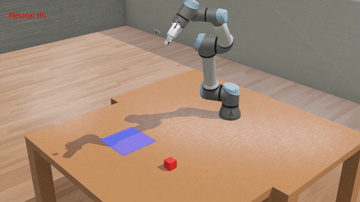
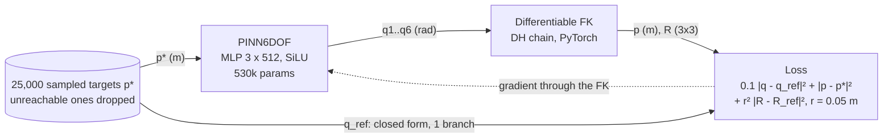
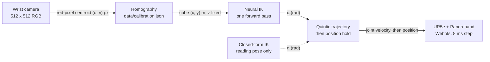
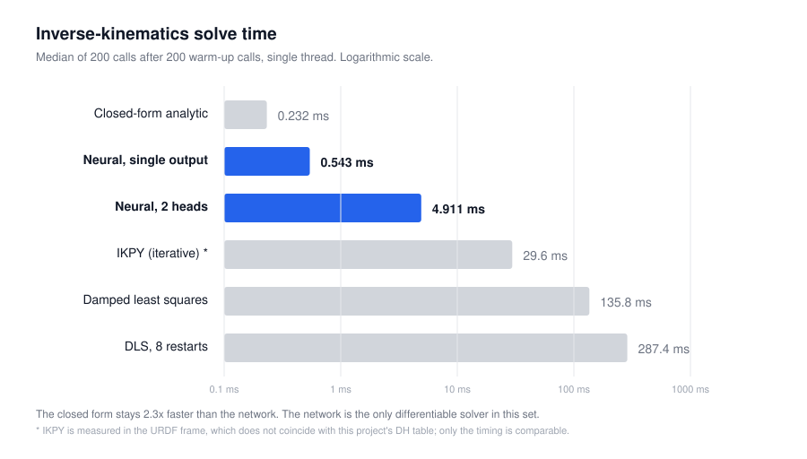

# UR5e Neural Kinematics: position IK trained through a differentiable forward model

An MLP solves position inverse kinematics for a simulated UR5e (tool pointing down) at 0.19 mm mean error on 2,021 held-out targets and 0.53 ms per solve, and drives a camera-guided pick-and-place in Webots.

[Paper (PDF, 12 pages)](paper/main.pdf) · [Experiment tables](docs/experiments.md) · [Credits](CREDITS.md)

[](https://github.com/clementdumeril/ur5e-neural-kinematics/actions/workflows/smoke.yml)
[](LICENSE)



*One run of [`my_first_simulation_pandahand.wbt`](webots/worlds/my_first_simulation_pandahand.wbt) at 2x speed. The network solves the cube and tray moves; the camera reading pose uses the closed form.*

## Overview

The network maps a target position (x, y, z) to six joint angles. During training the predicted angles go through a batched PyTorch copy of the UR5e Denavit-Hartenberg chain, so the loss is measured on the pose the arm reaches and not only on the angles. Labels come from the closed-form IK on one branch (shoulder left, elbow up, wrist up). Personal project, August to October 2026, simulation only.

The Webots scene, the NumPy forward kinematics, the closed-form IK and the device wrappers come from [`allan-almeida1/ur5-pick-and-place-webots`](https://github.com/allan-almeida1/ur5-pick-and-place-webots) (MIT). I wrote the differentiable FK, the network and its loss, the dataset generator, the multi-seed study, the multi-head variant, the Jacobian and damped least-squares baselines, the solver benchmark, the color detector and homography calibration, the joint position hold, and a fix to the inherited closed form (every elbow-down solution was about 0.78 m off). [`CREDITS.md`](CREDITS.md) gives the file-by-file split.



*Training ([`train_true_pinn.py`](src/training/train_true_pinn.py)): Adam 1e-3 with step decay to 2e-5, batch 256, 100 epochs, about 8 min on a laptop CPU. At inference only the MLP runs.*



*Pick-and-place loop ([`ur5_controller_pandahand.py`](webots/controllers/ur5_controller_pandahand/ur5_controller_pandahand.py), [`ur5.py`](src/control/ur5.py)). The camera image is taken once, at a fixed reading pose; the tray position is read from the Webots supervisor, not from the camera.*

## Results

Accuracy on held-out targets (test split of [`seed_study.py`](experiments/seed_study.py), never used for training or epoch selection):

| Model | N | Position error (mm) | Orientation error (deg) | Source |
| :-- | --: | --: | --: | :-- |
| Shipped checkpoint | 2,021 targets | 0.191 mean, 0.164 median, 0.426 p95 | 0.0087 | [`C_shipped.json`](results/seed_study/C_shipped.json) |
| Same recipe, FK loss on | 5 seeds | 0.214 ± 0.039 | 0.0090 ± 0.0013 | [`A_wphys1_seed*.json`](results/seed_study/) |
| Baseline: angle loss only, no FK term | 5 seeds | 0.241 ± 0.021 | 0.0088 ± 0.0009 | [`A_wphys0_seed*.json`](results/seed_study/) |
| Multi-head, K = 8, branch-mixed data, no labels | 3 seeds | 0.305 ± 0.046, recall 50.6 ± 9.3 % of 8 branches | 0.25 ± 0.05 | [`D_K8_seed*.json`](results/seed_study/) |

Mean ± std over seeds. On single-branch data the FK term lowers the error by 11 % on average, which is not significant (95 % CI [-13, +34] %, p = 0.26; it helps in 3 of 5 seeds). An earlier single-run estimate of -21 % did not hold up. All values are generated into [`paper/numbers.tex`](paper/numbers.tex).

Solve time on 200 pose targets, one thread, warm-up on other targets ([`benchmark.json`](results/benchmark/benchmark.json)):

| Solver | Median time (ms) | Failure rate |
| :-- | --: | --: |
| Closed-form analytic (inherited, fixed) | 0.232 | 0 % |
| Neural IK, single output | 0.531 | 0 % |
| IKPy, same DH chain and orientation | 38.1 | 58 % |
| Damped least squares, one start | 136.0 | 59.5 % |
| Damped least squares, 8 restarts | 270.0 | 0 % |



The network is 2.3x slower than the closed form and 72x faster than IKPy on the same problem. In closed loop in Webots (one run, one cube position, [`closed_loop_console.txt`](results/webots/closed_loop_console.txt)) the network reaches the grasp point within 0.33 mm and the approach point within 0.45 mm of the closed-form pose. The two tray points, outside the training box, are 10.9 and 7.3 mm off; the cube still lands in the tray (end of the GIF).

## Installation

Tested on Windows 10 with Python 3.11.9 and Webots R2025a, CPU only (Intel i7-6700HQ). CI runs the smoke test on Ubuntu with Python 3.11.

```bash
git clone https://github.com/clementdumeril/ur5e-neural-kinematics.git
cd ur5e-neural-kinematics
pip install -r requirements.txt     # or requirements-tested.txt for the exact versions used
```

The `controller` module comes with Webots and is not installed by pip. TensorFlow, scikit-image and OpenCV are only needed for the optional VGG16 mode (see `requirements.txt`).

## Usage

```bash
python tests/test_smoke.py          # about 1 min; ends with "Tout est vert." after 8 branches at ~1e-13 mm
```

For the simulation, open `webots/worlds/my_first_simulation_pandahand.wbt` in Webots R2023a or later and press Play. The first launch downloads the PROTOs. The console prints `[Grasp] SUCCESS: the cube followed the arm.` and a `NEURAL IK ERROR MEASURED IN WEBOTS` block like the one in `results/webots/closed_loop_console.txt`. To force a Python interpreter, set `COMMAND` under `[python]` in `webots/controllers/*/runtime.ini`.

Retraining and experiments:

| Command | Time | Output |
| :-- | --: | :-- |
| `python src/training/train_true_pinn.py` | ~8 min | `checkpoints/pinn_model_true_physics.pth` |
| `python experiments/seed_study.py` (parts A to C) | ~3 h | `results/seed_study/*.json` |
| `SEED_PART=D python experiments/seed_study.py` | ~2.5 h | `results/seed_study/D_*.json` |
| `python experiments/benchmark_solveurs.py` | ~6 min | `results/benchmark/benchmark.json` |
| `python experiments/verify_paper.py` | ~1 min | `results/verification/verification.json` |

## Reproducing figures and numbers

```bash
python paper/make_numbers.py          # paper/numbers.tex from the result files
python paper/make_figures.py          # paper/figures/*.pdf, assets/fig_ablation.svg, assets/fig_multihead.svg
python experiments/figures.py         # assets/fig_benchmark.svg, assets/fig_architecture.svg
python experiments/heatmap_erreur.py  # assets/fig_workspace_error.png
```

## Code structure

| Component | File | Role |
| :-- | :-- | :-- |
| Differentiable FK | [`src/kinematics/ur5_pytorch_fk.py`](src/kinematics/ur5_pytorch_fk.py) | Batched DH chain in PyTorch |
| Network | [`src/models/pinn.py`](src/models/pinn.py) | `PINN6DOF`, normalisation stored in the checkpoint |
| Multi-head network | [`src/models/multihead.py`](src/models/multihead.py) | K heads, relaxed winner-take-all loss |
| Training | [`src/training/train_true_pinn.py`](src/training/train_true_pinn.py) | Dataset generation and the shipped model |
| Baselines | [`jacobian.py`](src/kinematics/jacobian.py), [`ik_dls.py`](src/kinematics/ik_dls.py), [`ikpy_ur5e_solver.py`](src/kinematics/ikpy_ur5e_solver.py) | Geometric Jacobian, damped least squares, IKPy chain |
| Robot interface | [`src/control/ur5.py`](src/control/ur5.py) | Inherited closed form (fixed), vision, trajectories, position hold |
| Experiments | [`experiments/`](experiments/) | Seed study, benchmark, verification, figures |
| Simulation | [`webots/`](webots/) | Worlds and controllers |
| Paper | [`paper/`](paper/) | `main.tex`, generated numbers and figures |

## Limitations

- Position IK only, at one tool orientation and on one IK branch. "6-DoF" describes the robot, not the problem solved.
- Outside the training box the error grows: 14.3 mm median against 0.176 mm inside, on a z = 0.25 m slice. Past the reach limit the network still returns six angles, up to 1.78 m off, with no warning. It needs a reachability check in front of it.
- The closed-loop Webots figure comes from one run and one cube position, not a success rate over many trials.
- The upstream VGG16 detector (frozen backbone, trained regression head) was less accurate than the color threshold on this scene and is kept only as an option. The vision error figures in the repository come from different measurements and do not agree, so none is quoted here.
- Simulation only; no test on hardware.

## Citation and license

```bibtex
@misc{dumeril2026ur5e,
  author = {Dumeril, Cl{\'e}ment},
  title  = {Neural Inverse Kinematics Trained Through a Differentiable Forward Model: A Multi-Seed Study on the UR5e},
  year   = {2026},
  url    = {https://github.com/clementdumeril/ur5e-neural-kinematics}
}
```

MIT, see [`LICENSE`](LICENSE), which carries both copyright notices (Clément Dumeril 2026, Allan Souza Almeida 2023). The Webots scene and the base of `src/control/ur5.py` come from [`allan-almeida1/ur5-pick-and-place-webots`](https://github.com/allan-almeida1/ur5-pick-and-place-webots).

Clément Dumeril, UC Berkeley MEng · [clement.dumeril.net](https://clement.dumeril.net)
