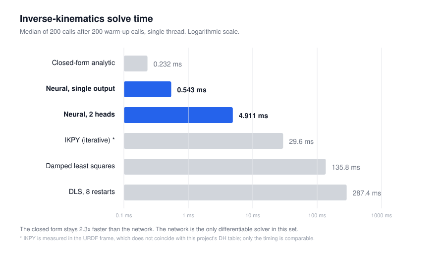

# Method details and reproduction

Back to the [README](../README.md). Result tables: [experiments.md](experiments.md). Full protocol: [`paper/main.pdf`](../paper/main.pdf).

## Training

[`train_true_pinn.py`](../src/training/train_true_pinn.py). 25,000 targets are sampled in the training box and the unreachable ones dropped. Labels come from the closed-form IK on one branch (shoulder left, elbow up, wrist up). The network, `PINN6DOF` ([`pinn.py`](../src/models/pinn.py)), is an MLP with 3 hidden layers of 512 and SiLU, 530k parameters. The predicted angles go through a batched PyTorch copy of the UR5e DH chain ([`ur5_pytorch_fk.py`](../src/kinematics/ur5_pytorch_fk.py)), and the loss is

`0.1 |q - q_ref|² + |p - p*|² + r² |R - R_ref|²`, with r = 0.05 m.

Adam 1e-3 with step decay to 2e-5, batch 256, 100 epochs, about 8 min on a laptop CPU. At inference only the MLP runs.

## Pick-and-place loop

[`ur5_controller_pandahand.py`](../webots/controllers/ur5_controller_pandahand/ur5_controller_pandahand.py), [`ur5.py`](../src/control/ur5.py). The wrist camera (512 x 512 RGB) takes one image at a fixed reading pose; the red-pixel centroid goes through a homography ([`data/calibration.json`](../data/calibration.json)) to the cube's (x, y) at a fixed z. The network solves the cube and tray moves, the closed form solves the reading pose. Each move is a quintic joint trajectory followed by a position hold, on a UR5e with a Panda hand, 8 ms Webots step. The tray position is read from the Webots supervisor, not from the camera.

## Commands

| Command | Time | Output |
| :-- | --: | :-- |
| `python src/training/train_true_pinn.py` | ~8 min | `checkpoints/pinn_model_true_physics.pth` |
| `python experiments/seed_study.py` (parts A to C) | ~3 h | `results/seed_study/*.json` |
| `SEED_PART=D python experiments/seed_study.py` | ~2.5 h | `results/seed_study/D_*.json` |
| `python experiments/benchmark_solveurs.py` | ~6 min | `results/benchmark/benchmark.json` |
| `python experiments/verify_paper.py` | ~1 min | `results/verification/verification.json` |

## Figures and numbers

```bash
python paper/make_numbers.py          # paper/numbers.tex from the result files
python paper/make_figures.py          # paper/figures/*.pdf, assets/fig_ablation.svg, assets/fig_multihead.svg
python experiments/figures.py         # assets/fig_benchmark.svg, assets/fig_architecture.svg
python experiments/heatmap_erreur.py  # assets/fig_workspace_error.png
```

`docs/figures/overview.svg` is drawn by hand from crops of `paper/figures/` and `assets/fig_workspace_error.png`, and rendered to `overview.png` at 2x with headless Chrome.



## Notes

- The first Webots launch downloads the PROTOs. To force a Python interpreter, set `COMMAND` under `[python]` in `webots/controllers/*/runtime.ini`.
- TensorFlow, scikit-image and OpenCV are only needed for the optional VGG16 mode (see `requirements.txt`). That detector (frozen backbone, trained regression head) was less accurate than the color threshold on this scene. The vision error figures in the repository come from different measurements and do not agree, so none is quoted.
- An earlier single-run estimate of the FK term's effect (-21 %) did not hold up over 5 paired seeds (-11 %, not significant).
